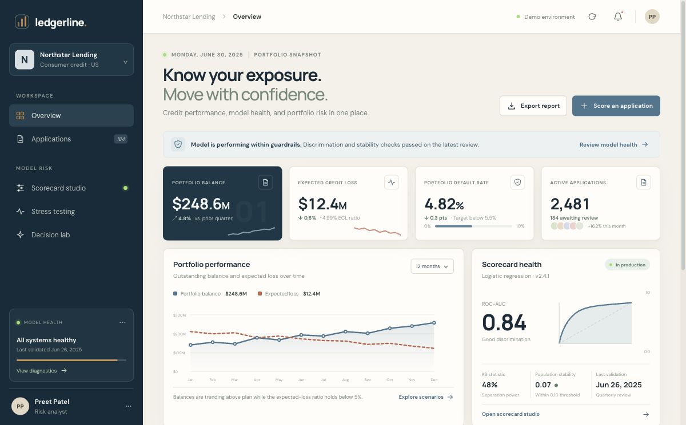

# Ledgerline — Enterprise Credit Risk Assessment & Scorecard System

An interactive credit-risk portfolio dashboard and scorecard workbench built around the project described in Preet Patel's resume. It brings portfolio expected loss, application review, interpretable WOE/IV analysis, stress testing, and a hypothetical scoring sandbox into one responsive experience.

**Live demo:** [ledgerline-credit-risk-demo.vercel.app](https://ledgerline-credit-risk-demo.vercel.app)

## Dashboard preview



[View the mobile preview](screenshots/overview-mobile.png).

## What is included

- **Portfolio overview:** exposure, expected credit loss, default rate, application throughput, model health, and risk by borrower tier.
- **Application queue:** searchable and filterable example applications with CSV export.
- **Scorecard studio:** feature information value, editable navigation across WOE bins, and a plain-language methodology panel.
- **Stress testing:** baseline, moderate, severe, or custom interest-rate and unemployment shocks with transparent sensitivity assumptions.
- **Decision lab:** a client-side hypothetical application form that calculates a transparent illustrative risk band and score.
- **Analytics foundation:** reproducible synthetic data generation, logistic-regression training and holdout validation, SQL schema and portfolio queries, plus Power BI DAX measure definitions.

## Run the dashboard

The dashboard is a standalone Next.js app in this directory. From this folder:

```sh
npm install
npm run dev
```

Open `http://localhost:3001`. For a production build, run `npm run build` and `npm run start`.

## Run the analytical pipeline

Use Python 3.10+ and install the dependencies in `requirements.txt`:

```sh
python -m pip install -r requirements.txt
python modeling/generate_synthetic_data.py --rows 50000
python modeling/train_scorecard.py
```

The reproducible generator writes a local, ignored `data/synthetic_applications.csv`. Training writes holdout metrics, WOE/IV summaries, and coefficient diagnostics under the ignored `artifacts/` directory. You can provide a compatible CSV with `--input`. The script computes metrics from the CSV it receives; generated data is only for pipeline development and does not support claims about actual borrowers or lending outcomes.

## Data and metric integrity

The UI shows **synthetic demo records** and illustrative portfolio totals. Its ROC-AUC (0.84) and KS statistic (48%) mirror the supplied resume brief; the demo UI does not represent that they were reproduced from a source portfolio dataset. The local synthetic modeling pipeline reports its own measured holdout values in `artifacts/validation_metrics.json` and labels its sample as synthetic. Do not substitute those values for real-world validation.

The stress test uses documented sensitivity multipliers, not a macroeconomic forecast or IFRS 9/ECL production engine. The decision lab runs locally in the browser and is not a lending decision. No applicant data is transmitted or stored.

## Project structure

```text
app/                       Next.js product interface and responsive styles
modeling/                  Synthetic sample generator and scorecard training
sql/                       Relational schema and portfolio analysis queries
powerbi/                   DAX measure definitions for a Power BI report
PRODUCT.md                 Product scope, user flows, and data truth
requirements.txt           Python analytics dependencies
```

## Data model

`application` stores an application-grain request, input fields, score, predicted probability, and decision. `performance_outcome` stores matured outcomes separately. `scorecard_bin` versions WOE mappings over time. `model_validation` captures holdout/model monitoring metrics and whether the evaluated sample is synthetic. The SQL uses PostgreSQL syntax. The schema is a development foundation and needs institution-specific privacy controls, access policies, and definitions before use with lending data.

## Resume alignment

**Enterprise Credit Risk Assessment & Scorecard System** — Python (Scikit-Learn, Statsmodels), SQL, Power BI, DAX, logistic regression.

- Assessed 50,000+ consumer credit applications to estimate default probabilities and support lending decisions.
- Applied WOE transformations and IV feature screening to an interpretable logistic-regression scorecard; the supplied project brief cites 0.84 ROC-AUC and a 48% KS statistic.
- Designed portfolio expected-loss and provision-buffer reporting for changing macroeconomic assumptions.

The resume claims above are project targets supplied with the brief. This repository distinguishes those claims from outputs computed on generated synthetic data.
